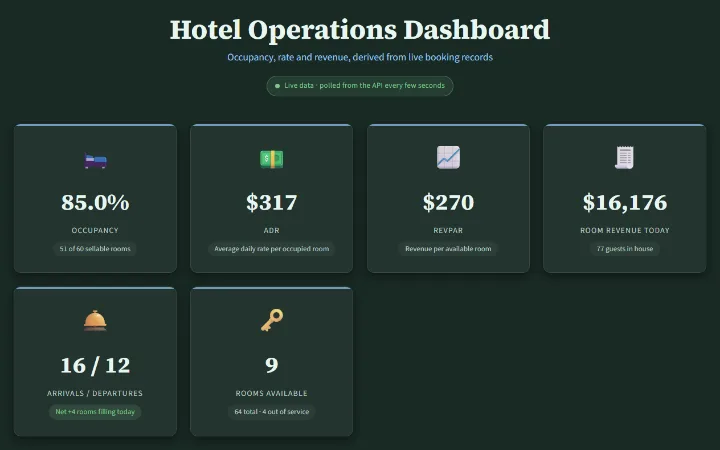
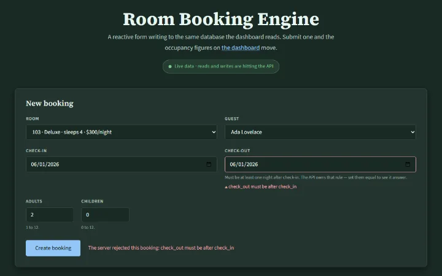
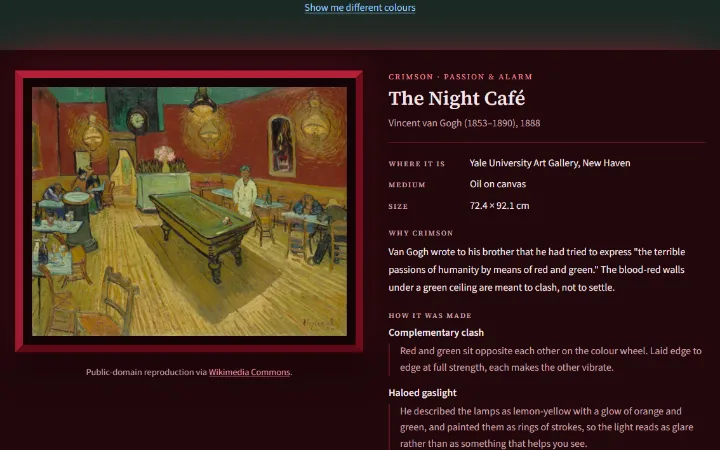
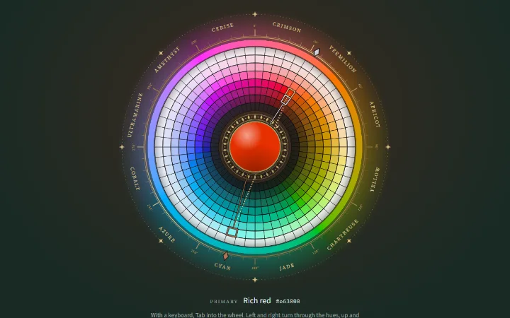
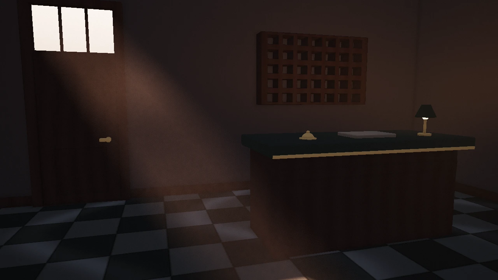
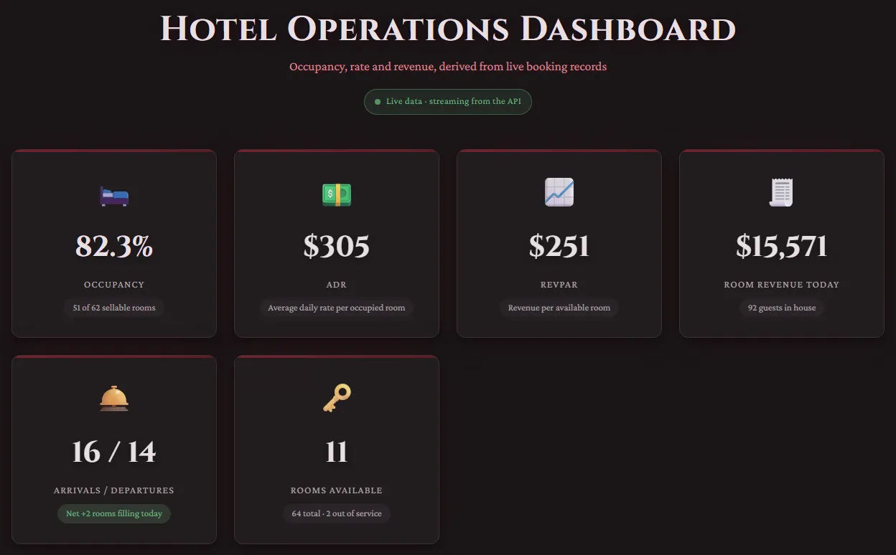

# EtherealHotel

[](https://github.com/mille409Fog/ethereal-hotel/actions/workflows/code-quality.yml)
[](https://github.com/mille409Fog/ethereal-hotel/actions/workflows/supply-chain.yml)

**Live: https://jacobmiller.dev/**

Jacob Miller's portfolio: Angular 22 and FastAPI, deployed as one Vercel project. It holds
several separate pieces of work, and one rule covers all of them. Every number on screen is
derived from something real. When the app can't do something, the page says so instead of
pretending.

## What's here

- **[`/dashboard`](https://jacobmiller.dev/dashboard)**: occupancy, ADR, RevPAR and revenue
  computed from booking rows in SQLite. It degrades from WebSocket to polling to a committed
  fixture, and a badge names which one you're looking at.
- **[`/booking`](https://jacobmiller.dev/booking)**: a reactive form that writes to the database
  the dashboard reads. Server-side validation renders on the field that caused it.
- **[`/murmuration`](https://jacobmiller.dev/murmuration)**: _in progress._ A cauldron of batoids
  in three.js, written slowly and by hand on purpose. Each commit is logged at
  [`/writing`](https://jacobmiller.dev/writing).
- **[`/gallery`](https://jacobmiller.dev/gallery)**: choose a colour and a painting is hung for
  it, from 24 public-domain works in 7 colour groups. Every label is checked against a source.
- **[`/aesthetic`](https://jacobmiller.dev/aesthetic)**: a wheel of 480 colours computed in OKLCH.
  You pick one, and a published model of colour harmony picks the other two and shows its
  reasoning.
- **[`/aubade`](https://jacobmiller.dev/aubade)**: Hôtel Aubade, six floors of a hotel raymarched
  in a fragment shader and lit by the real sun, with no 3D library. It is a separate work.
- **[`/work`](https://jacobmiller.dev/work)**: three case studies from NDA engagements. The code
  can't be shown; the reasoning can.
- **[`triage/`](triage/docs/PROJECT_BRIEF.md)**: not a route. An agent that explains why this
  repo's own CI failed, built in eight stages (five done), at $0 beyond a Claude Pro subscription.

<table>
  <tr>
    <td></td>
    <td></td>
  </tr>
  <tr>
    <td></td>
    <td></td>
  </tr>
  <tr>
    <td></td>
    <td></td>
  </tr>
</table>

_The five portfolio frames aren't mock-ups. `npm run frames:capture` photographs each route from
the production build, and `npm run e2e` fails when a committed frame stops matching the app.
The lobby is one of the frames `npm run verify:shader` renders._

## Run it

```bash
npm install && npm start          # Angular on :4200
npm run start:backend             # FastAPI on :8000
```

The dashboard works without the backend. It falls back to a committed snapshot and labels itself
"simulated data". Full setup, including the Python virtualenv, is in
[CONTRIBUTING.md](CONTRIBUTING.md).

## Three decisions worth arguing about

**The app tells you which data you're looking at instead of hiding the difference.** The
dashboard takes metrics from a WebSocket, from polling or from a committed fixture, and the header
badge names which one is live. The hosted demo is a serverless function that can't hold a socket
open, so it polls and says "polled". The stream is a real feature of the container deployment,
not a claim the demo makes and can't keep. `/booking` deliberately has _no_ fixture fallback: a
form whose whole claim is that it writes a durable row can't honestly fake one.
→ [Transport and degradation](ARCHITECTURE.md#transport-and-degradation)



_Fifteen unedited seconds of the container deployment (`cd backend && docker compose up -d`). The
guests-in-house figure moves on each broadcast tick and nothing else does, because nothing else in
the database changed. `npm run capture:stream` records this._

**The booking rule exists once, on the server, and its error knows which field it belongs to.**
Check-out must be at least one night after check-in. That rule lives in
`backend/services/bookings.py` and has no counterpart in the browser. The message in the booking
frame above is a real 422, rendered under the input that caused it because the error carries the
field name on the wire. A second copy of the rule in TypeScript would render faster, and one
refactor later it would disagree with the server.
→ [How a rejected booking comes back](ARCHITECTURE.md#how-a-rejected-booking-comes-back)

**One `create_app()` builds both deployments, and they run different Python versions on
purpose.** The serverless demo and the container differ by a single `live_stream` flag, not a
fork. Vercel's runtime has no Python 3.11, so the function runs 3.12 while the container and the
linters target 3.11. The CI matrix runs both rather than assuming the gap is harmless, and
`test_dependency_pins.py` fails if the two dependency lists drift.
→ [Deployment](ARCHITECTURE.md#deployment)

## Gates

Six commands, all of them CI jobs: `npm run code-quality`, `npm test`, `npm run test:scripts`,
`npm run code-quality:py`, `npm run test:backend` and `npm run test:triage`. CI also runs
Playwright and axe (`npm run e2e`) and dependency audits over both languages. On top of those,
`npm run check:docs` fails when the docs stop matching the repo, and `npm run resume:check` fails
when the committed résumé PDF has drifted from the data it's rendered from.
[CONTRIBUTING.md](CONTRIBUTING.md) has the commands. Accessibility is a build gate, and the
reasoning behind its two non-obvious choices is in [Accessibility](ARCHITECTURE.md#accessibility).

Performance and accessibility are budgets. `npm run lighthouse` audits the production build on
`/`, `/dashboard` and `/gallery` with the desktop profile, three runs, asserted against the
median. The build **fails** below **performance 90**, **accessibility 100** and
**best practices 95**. Size has a ceiling too: `angular.json` caps the **initial payload at 350 kB**
and **all scripts at 2500 kB**. Both ceilings leave generous headroom, because a margin of a few
kilobytes failed Vercel deploys that passed locally. The warnings sit just above today's build, so
growth shows up long before it fails. `npm run check:docs` fails if these numbers and the configs
that enforce them disagree.

The initial payload is the number to watch: 263 kB (76 kB over the wire), Angular and the router
included. Every piece of work above is a lazy route, so a visitor to `/` downloads none of them.
The largest is `/murmuration`'s three.js, about 570 kB in a chunk of its own. `/aubade` puts its
renderer behind a second dynamic import, so its shaders reach a browser only when someone opens
that page, and its Reader's Edition at `/aubade/reader` creates no WebGL context at all.
`npm run verify:shader` compiles the GLSL in headless Chromium and renders a frame. Without it,
GLSL would be the only code here whose compiler first ran in production.

## More

- [ARCHITECTURE.md](ARCHITECTURE.md): transports, the API surface, deployment, configuration
- [backend/README.md](backend/README.md): schema, seeding, streaming internals, Alembic
- [CONTRIBUTING.md](CONTRIBUTING.md): setup and the gates
- [AUBADE.md](AUBADE.md) and [GALLERY.md](GALLERY.md): the specs for those two pieces
- [triage/docs/](triage/docs/): the CI triage agent's brief, architecture and results
- [docs/analytics.md](docs/analytics.md): what the site measures, and why there's no cookie banner

[MIT](LICENSE) © Jacob Miller
