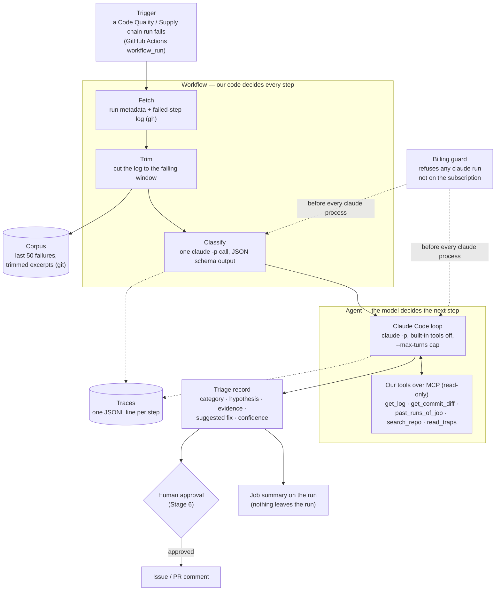

# CI Triage — Architecture

How the pieces fit. What it is for, and the numbers it has to hit, are in
[PROJECT_BRIEF.md](PROJECT_BRIEF.md). Why each choice was made is in
[decisions/](decisions/).

## The shape

Mostly workflow, with one agent where the path genuinely varies
([ADR 0001](decisions/0001-hybrid-on-the-subscription.md)).

## What exists today

The billing guard and the data pipeline are built. Everything else in the diagram is
the plan, and each item lands in the stage named here.

| Piece                               | Where                                                     | Status                                        |
| ----------------------------------- | --------------------------------------------------------- | --------------------------------------------- |
| Billing guard                       | `ci_triage/billing_guard.py`, `ci_triage/claude_cli.py`   | **Built.** `npm run triage:doctor` runs it    |
| Fetch, trim, corpus                 | `ci_triage/fetch.py`, `trim.py`, `corpus.py`, `github.py` | **Built.** Corpus in `triage/data/corpus/`    |
| Fix evidence, labels, freeze        | `ci_triage/labels.py`, `triage/data/labels.json`          | **Built.** Golden set frozen once confirmed   |
| Rule baseline + scorecard           | `ci_triage/baseline.py`, `ci_triage/evaluate.py`          | **Built.** Scores in [RESULTS.md](RESULTS.md) |
| Classify (single LLM call)          | —                                                         | Stage 3                                       |
| Agent loop + MCP tools              | —                                                         | Stage 4                                       |
| Trigger in Actions, resumable state | —                                                         | Stage 5                                       |
| Approval gate, injection defences   | —                                                         | Stage 6                                       |
| Larger golden set, LLM-as-judge     | —                                                         | Stage 7                                       |
| Traces dashboard                    | —                                                         | Stage 8                                       |

## The building blocks, mapped

- **The model call** is `claude -p`, never the API. Each call is a fresh, stateless
  process, so whatever the model needs has to be in the prompt or reachable by a tool.
- **Prompts** will live as versioned files under `triage/prompts/`, so a prompt change
  shows up in a diff and can be evaluated.
- **Tools** are read-only Python functions served over MCP to Claude Code's loop. MCP
  is used here because the loop belongs to a program we don't control, and MCP is how
  that program accepts outside tools. Where we own the loop, tools are plain functions.
- **State** for one triage is the run id plus the evidence gathered so far, persisted
  after each step from Stage 5 so a killed run resumes rather than restarts.
- **Orchestration** is our code for the workflow half and Claude Code's loop for the
  agent half.
- **Memory**: short-term is the context of one run. Long-term is the corpus of past
  failures and `CLAUDE.md` §Traps, which is a hand-written record of past root causes.

## Running now vs. queuing

A triage is short (target ≤ 2 minutes), but it must not be lost if a runner dies. We
don't build a queue: a `workflow_run` event in GitHub Actions is already durable, retried
and free on a public repository
([ADR 0003](decisions/0003-actions-as-the-queue-files-as-storage.md)).

## Money

No path in this system can bill anything beyond the Claude Pro subscription. Four layers
make that true, and the brief's §Cost ceiling explains why it matters.
[ADR 0004](decisions/0004-a-fail-closed-billing-guard.md) describes them.

## Commands

| Command                   | What it does                                                                   |
| ------------------------- | ------------------------------------------------------------------------------ |
| `npm run test:triage`     | pytest over `triage/tests/`                                                    |
| `npm run code-quality:py` | ruff and mypy-strict, over `triage/` along with `backend/` and `api/`          |
| `npm run triage:doctor`   | Runs the billing guard against this machine and says whether `claude` may run  |
| `npm run triage:fetch`    | Adds new failed runs to the corpus and rotates it to 50 runs (`gh`, read-only) |
| `npm run triage:label`    | Finds each new case's fix in history and adds it to `labels.json`              |
| `npm run triage:freeze`   | Copies confirmed labels into the golden set, once                              |
| `npm run triage:eval`     | Scores the rule baseline against the golden set                                |

None of these runs on its own: the project is off by default
([ADR 0005](decisions/0005-off-by-default.md)).
